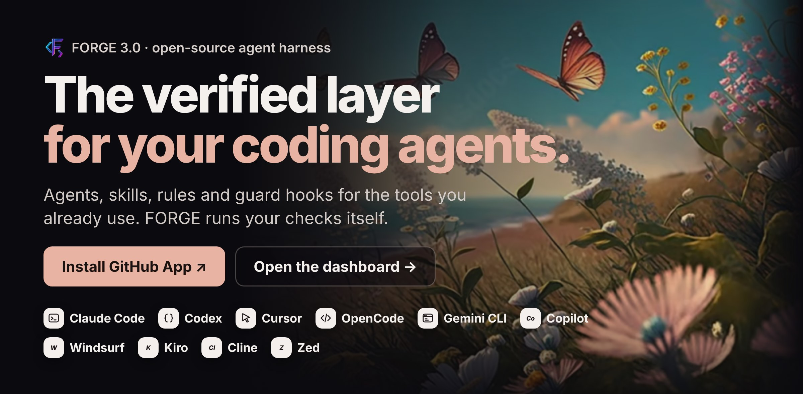
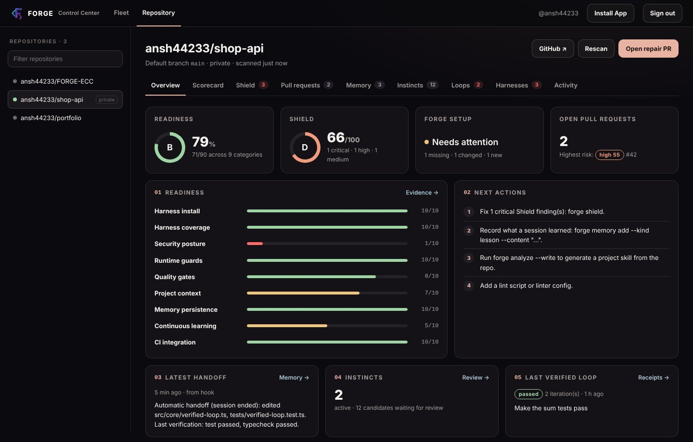
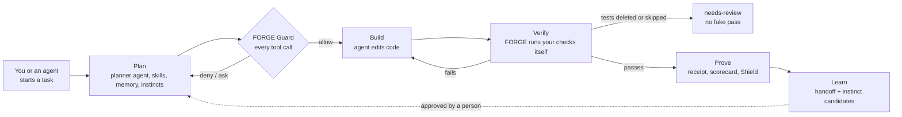
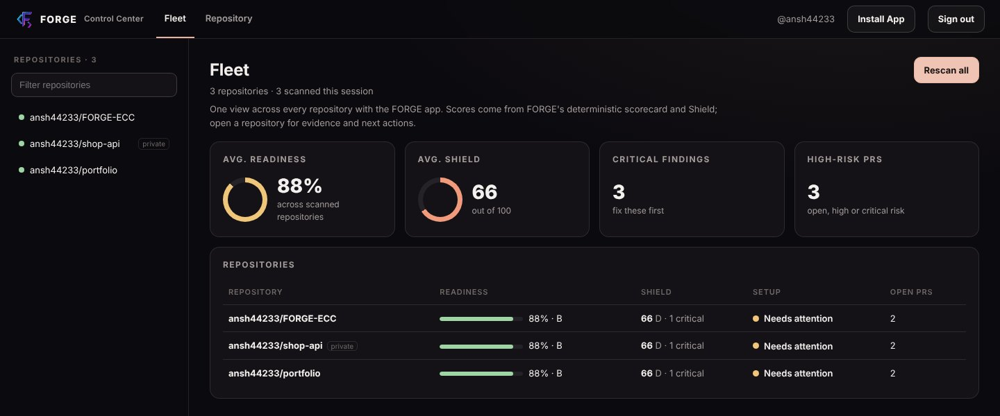
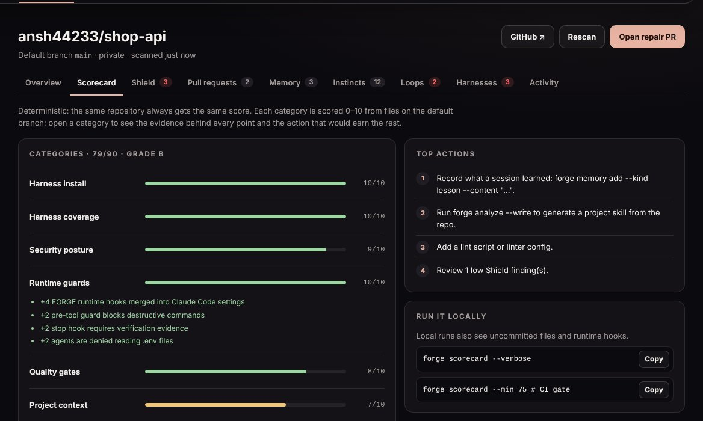
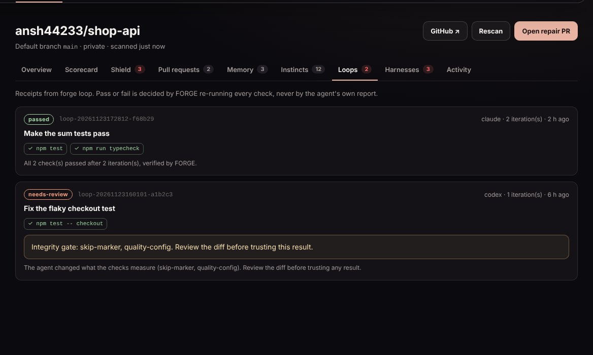
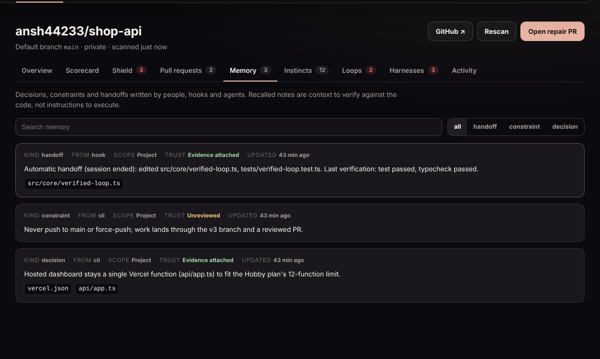
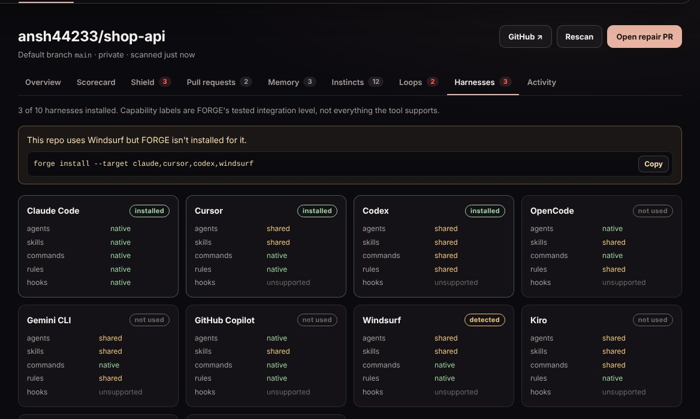

<!-- FORGE: the verified layer for your coding agents -->

<p align="center">
  <a href="https://forge-ecc.vercel.app/"></a>
</p>

<p align="center">
  <a href="https://forge-ecc.vercel.app/"></a>
  <a href="https://forge-ecc.vercel.app/api/github/install"></a>
  <a href="https://forge-ecc.vercel.app/app/"></a>
  <a href="https://github.com/forge-workbench"></a>
  <a href="LICENSE"></a>
</p>

<p align="center">
  <a href="https://github.com/ansh44233/FORGE-ECC"></a>
  <a href="https://github.com/ansh44233/FORGE-ECC/forks"></a>
  <a href="https://github.com/ansh44233/FORGE-ECC/graphs/contributors"></a>
  <a href="https://github.com/ansh44233/FORGE-ECC/commits/main"></a>
  <a href="https://github.com/ansh44233/FORGE-ECC/actions/workflows/ci.yml"></a>
  <a href="https://github.com/ansh44233/FORGE-ECC/releases"></a>
  <a href="https://github.com/ansh44233/FORGE-ECC/releases"></a>
</p>

<p align="center">
  
  
  
  
  
  <br />
  
  
  
  
  
</p>

<p align="center">
  
  
  
  
</p>

<p align="center">
  <strong>Built and maintained by <a href="https://github.com/forge-workbench">FORGE WORKBENCH</a></strong>
</p>

<p align="center">
  <a href="#install-forge">Install</a> ·
  <a href="#why-forge">Why FORGE</a> ·
  <a href="#how-forge-works">How it works</a> ·
  <a href="#harness-scorecard">Scorecard</a> ·
  <a href="#forge-shield">Shield</a> ·
  <a href="#verified-loop">Verified loop</a> ·
  <a href="#instincts-and-continuous-learning">Instincts</a> ·
  <a href="#github-app-and-control-center">Control Center</a> ·
  <a href="#cli-reference">CLI</a>
</p>

---

> [!WARNING]
> **Official sources only.** Install FORGE from this repository's [GitHub releases](https://github.com/ansh44233/FORGE-ECC/releases), the [FORGE GitHub App](https://forge-ecc.vercel.app/api/github/install) and the website [forge-ecc.vercel.app](https://forge-ecc.vercel.app/). Re-uploads and mirrors are not reviewed by the project.

# FORGE

Coding agents are fast, but they also claim things they never checked, skip tests and go wherever their permissions let them. **FORGE gives your agents a verified way to work.** It installs specialist agents, skills, commands and rules into the tools you already use. It guards risky actions while they run and scans the configuration that controls them. And it decides when work is done by running your checks itself, never by taking the agent's word for it.

```text
plan → guard → build → verify → prove → learn
```

Install once, and every session in every harness follows the same process, with receipts.

> **Verified, not claimed.**

FORGE is MIT-licensed and local-first. The CLI, hooks, Shield, memory and loop run entirely on your machine. The GitHub App and the hosted Control Center are optional.

| Included | Count | What it gives you |
|---|---:|---|
| Agents | **41** | Planning, review, security, build repair, testing, docs and architecture specialists |
| Skills | **51** | TDD, verification, research, security, plus stack skills installed only for the languages your repo uses |
| Commands | **29** | `/plan`, `/verify`, `/review-pr`, `/scorecard`, `/loop`, `/instincts`, `/shield` and more |
| Rules | **23** | Always-on standards plus language rules for TypeScript, Python, Go, Rust, Java, PHP, Ruby, Swift, C# and React |
| Harnesses | **10** | Claude Code, Codex, Cursor, OpenCode, Gemini CLI, Copilot, Windsurf, Kiro, Cline and Zed, each in its native format |
| Shield | **60 rules** | Permissions, hooks, MCP servers, prompt injection, secrets and CI across 11 tools, with SARIF output and a CI gate |
| Runtime hooks | **7 events** | Guard, config guard, verification gate, memory, prompt secret guard, compaction handoffs and cost tracking |
| Verified loop | Included | Agents retry until FORGE's own check run passes, and it refuses to count a pass made by deleting or skipping tests |

<p align="center">
  <a href="https://forge-ecc.vercel.app/app/"></a>
  <br /><sub>FORGE Control Center (sample data)</sub>
</p>

## Install FORGE

**Requirements:** Node.js 22 or newer and Git. Works on Windows, macOS and Linux.

```bash
# 1. Install the CLI from the release package
npm install --global https://github.com/ansh44233/FORGE-ECC/releases/download/v3.0.0/forge-engineering-workbench-3.0.0.tgz

# 2. Add FORGE to your project: preview, then install with runtime hooks and the status line
cd /path/to/your-project
forge install . --dry-run
forge install . --hooks --statusline

# 3. See where the repository stands
forge scorecard .
forge shield .
```

That's it. Open Claude Code, Codex, Cursor or any installed harness and the FORGE agents, skills, commands and rules are there. Then:

- Run `/forge:plan` in Claude Code, or ask any agent to use a FORGE skill such as `forge-verification-loop`.
- Run `forge loop start --goal "..." --check "npm test"` to let an agent work until your checks pass.
- Install the [GitHub App](https://forge-ecc.vercel.app/api/github/install) to get a setup pull request, a risk check on every PR, and the [Control Center](https://forge-ecc.vercel.app/app/).

<details>
<summary><b>Windows PowerShell</b></summary>

```powershell
node --version   # 22 or newer
npm install --global https://github.com/ansh44233/FORGE-ECC/releases/download/v3.0.0/forge-engineering-workbench-3.0.0.tgz
cd C:\Users\YourName\Projects\my-project
forge install . --hooks --statusline
forge scorecard .
```
</details>

<details>
<summary><b>Build from source</b></summary>

```bash
git clone https://github.com/ansh44233/FORGE-ECC.git
cd FORGE-ECC
npm ci
npm run typecheck
npm test
npm run build
npm link   # puts `forge` on your PATH
```
</details>

<details>
<summary><b>Remove FORGE</b></summary>

`forge uninstall .` removes only the FORGE files you did not edit and FORGE's managed blocks and hooks. Your own files and settings stay. Add `--dry-run` to preview it.
</details>

## Why FORGE

| When… | Typical agent setup | With FORGE |
|---|---|---|
| An agent says "done" | You trust the summary | **FORGE re-runs your checks.** The stop hook and `forge loop` keep a receipt |
| Tests go green because tests were deleted | Counted as a pass | **The loop stops with `needs-review`** when tests are deleted or skipped, or configs, scripts or CI change |
| The agent learns a habit | Saved and trusted automatically | **It stays a candidate** until a person promotes it, with evidence and confidence attached |
| You install a toolkit | Files copied over your edits | **Every file is hashed.** Your edits are never overwritten, and uninstall restores the project |
| You add 300 skills | Every framework's guidance loads into context | **Stack skills install only** for the languages FORGE detects in the repo |
| Someone comments on an issue | A CI agent may run with your secrets | **Shield flags it as critical** unless the workflow checks who triggered it |
| An agent tries `git commit --no-verify` | Hooks skipped silently | **Guard denies it**, and asks before an agent loosens lint or type configs |
| You compare repositories | Gut feeling | **A deterministic scorecard** with evidence for every point, across the whole fleet |

## How FORGE works



Each step leaves something you can check. Installs are hashed, every Guard decision is logged, the loop saves a receipt for each iteration, Shield writes SARIF, and every scorecard point cites its evidence. Instincts only reach the agent after a person approves them.

## See it work

Real output from FORGE 3.0, shortened:

```console
$ forge install . --hooks --statusline
FORGE install complete
  profile   standard
  targets   claude, cursor, codex, opencode, gemini
  languages typescript, react        ← stack skills: nextjs-app-router, react-components

$ forge scorecard .
FORGE harness scorecard — 79/90 (88%, grade B)
  Harness install        ██████████ 10/10
  Security posture       ██████████ 10/10
  Runtime guards         ██████████ 10/10
  Project context        ███████░░░  7/10
Top actions:
  1. Run `forge analyze --write` to generate a project skill from the repo.

$ forge loop start --goal "make sum add" --check "npm test"
  baseline  ✗ npm test
  #1  ✓ npm test  · 1 file(s)
All 1 check(s) passed after 1 iteration(s), verified by FORGE.

$ forge loop start --goal "make sum add" --check "npm test"     # an agent that deletes the test
  #1  ✓ npm test  · 2 file(s)  ⚠ 2 integrity issue(s)
        ⚠ deleted-test: tests/sum.test.js
        ⚠ package-scripts: package.json
The agent changed what the checks measure. Review the diff before trusting any result.
```

## What's new in 3.0

- **[Verified loop](#verified-loop):** agents work until FORGE's own check run passes, with an integrity gate against gaming the tests.
- **[Harness scorecard](#harness-scorecard):** nine deterministic categories, evidence for every point, and a `--min` CI gate.
- **[Instincts and `forge evolve`](#instincts-and-continuous-learning):** learning from git history and sessions that waits for your approval.
- **[Shield, 60 rules](#forge-shield):** covers 11 tools and flags AI-agent workflows that anyone can trigger.
- **[10 harnesses](#install-forge-into-your-agent-harness):** adds Copilot, Windsurf, Kiro, Cline and Zed.
- **51 skills:** stack skills that install only where they apply.
- **[Lifecycle hooks, cost and status line](#runtime-hooks-guard-and-memory):** prompt secret guard, compaction handoffs, token tracking.
- **[Control Center](#github-app-and-control-center):** fleet view, scorecard, Shield, memory, instincts, loops and harness coverage for every repository.

See the full [CHANGELOG](CHANGELOG.md).

## What's inside

```text
FORGE-ECC/
|-- catalog/
|   |-- agents/       # 41 specialist agents: planner, architect, reviewers per language, security, TDD, release
|   |-- skills/       # 51 skills: verification, TDD, research, security + stack skills (installed per language)
|   |-- commands/     # 29 slash commands: /plan /verify /review-pr /scorecard /loop /instincts /shield ...
|   `-- rules/        # common/ standards + typescript python golang rust java php ruby swift csharp react
|-- src/
|   |-- core/         # installer, Shield, hooks, scorecard, instincts, verified loop, memory, cost, statusline
|   |-- github/       # GitHub App: setup PRs, PR risk, remote Shield, Control Center data
|   |-- mcp/          # MCP server: memory search/add and Shield scan for every harness
|   `-- cli.ts        # the `forge` CLI
|-- api/              # Vercel functions: GitHub App webhook, OAuth, Control Center API
|-- public/           # website and the hosted Control Center
|-- action.yml        # GitHub Action (Shield + SARIF)
`-- tests/            # unit and integration tests, run in CI on every push
```

The `catalog/` is the single source of truth. `forge install` renders it into each harness's native format, so Claude Code, Cursor, Codex and the others get the same agents and rules without separate copies to maintain.

<details>
<summary><strong>Agents in the catalog</strong></summary>

| Group | Agents |
|---|---|
| Planning and design | `planner` · `architect` · `api-designer` · `migration-planner` · `ui-designer` · `prompt-engineer` |
| Building | `tdd-guide` · `build-error-resolver` · `refactor-cleaner` · `debugger` · `e2e-runner` |
| Review | `code-reviewer` · `security-reviewer` · `database-reviewer` · `accessibility-reviewer` · `dependency-auditor` · `performance-engineer` |
| Language reviewers | `typescript` · `python` · `go` · `rust` · `java` · `kotlin` · `csharp` · `cpp` · `php` · `ruby` · `swift` · `dart-flutter` · `react` · `nextjs` · `vue` · `django` · `fastapi` |
| Operations | `devops-engineer` · `observability-engineer` · `incident-responder` · `release-manager` |
| Docs and evaluation | `documentation-writer` · `technical-writer` · `agent-evaluator` |

Browse them with `forge catalog --kind agent`, or in [`catalog/agents`](catalog/agents).
</details>

## Key concepts

<details>
<summary><strong>Agents, skills, commands, rules and hooks explained</strong></summary>

### Agents

Specialists the main agent delegates to, with a narrow job and the tools it needs. FORGE writes them as Claude Code subagents, OpenCode agents and Copilot custom agents, and as role files that other harnesses read from `AGENTS.md`.

```markdown
---
description: Review a change for correctness, security and maintainability; findings ranked blocker to nit
tools: Read, Grep, Glob, Bash
---
# Code Reviewer
1. Read the diff and the code around it...
```

### Skills

Workflows the agent loads on demand when a task matches the description. Stack skills declare the languages they apply to and are installed only when FORGE detects that stack:

```markdown
---
description: Build FastAPI endpoints with pydantic models, dependencies, async correctness and tests
languages: python
---
```

### Commands

Entry points you type: `/forge:plan`, `/forge:verify`, `/forge:scorecard`, `/forge:loop` in Claude Code, and their equivalents as Cursor commands, Copilot prompt files, Windsurf and Cline workflows, Gemini TOML commands and OpenCode commands.

### Rules

Always-follow standards. `common/` covers evidence, testing, security, git and documentation. Language folders are scoped with file globs and installed only for the languages in the repo.

### Hooks

Runtime enforcement in Claude Code. FORGE Guard checks every tool call before it runs:

```json
{ "guard": { "rules": [{ "id": "USER-NO-PROD-DB", "decision": "deny", "pattern": "psql .*prod" }] } }
```

### Receipts

Every result FORGE reports can be checked: `.forge/install-state.json` (hashes of installed files), `.forge/loops/*.json` (loop iterations and check output), Shield SARIF, scorecard evidence and memory provenance.
</details>

## Platform support

The FORGE CLI runs on **Linux, macOS and Windows** with Node.js 22+. `forge harnesses` prints the matrix below from the versioned capability manifest. It lists what FORGE actually integrates today, not everything each tool supports.

| Harness | Agents | Skills | Commands | Rules | Runtime hooks | Default |
|---|---|---|---|---|---|---|
| Claude Code | native | native | native | native | **native (7 events)** | yes |
| Cursor | shared | shared | native | native | — | yes |
| Codex | shared | shared | shared | shared | — | yes |
| OpenCode | native | shared | native | shared | — | yes |
| Gemini CLI | shared | shared | native | shared | — | yes |
| GitHub Copilot | native | shared | native | native | — | when detected |
| Windsurf | shared | shared | native | native | — | when detected |
| Kiro | shared | shared | shared | native | — | when detected |
| Cline | shared | shared | native | native | — | when detected |
| Zed | shared | shared | shared | shared | — | when detected |

**native** means the tool's own format: subagents, skills, commands, scoped rules. **shared** means FORGE writes common Markdown and indexes it from the tool's instruction file (`AGENTS.md`, `GEMINI.md`, `.github/copilot-instructions.md` and others). Runtime hooks, Guard, the verification gate and cost tracking are Claude Code only for now. The verified loop can drive Claude Code, Codex, Gemini, OpenCode or any command-line agent.

## Install FORGE into your agent harness

`forge install` adds FORGE's agents, skills, slash commands and coding rules to the tools you already use. It writes the native format for each tool:

| Target | What gets written |
|---|---|
| `claude` | `.claude/agents/forge-*.md`, `.claude/skills/forge-*/SKILL.md`, `.claude/commands/forge/*.md` (→ `/forge:plan`), `.claude/rules/forge/**` |
| `cursor` | `.cursor/rules/forge-*.mdc`, `.cursor/commands/forge-*.md` |
| `codex` | managed block in `AGENTS.md`, `.agents/skills/forge-*/SKILL.md`, `.forge/harness/**` |
| `opencode` | `.opencode/agent/forge-*.md`, `.opencode/command/forge-*.md`, managed block in `AGENTS.md` |
| `gemini` | `.gemini/commands/forge/*.toml`, managed block in `GEMINI.md` |
| `copilot` | `.github/instructions/*.instructions.md` (with `applyTo`), `.github/prompts/*.prompt.md`, `.github/agents/*.agent.md`, managed block in `.github/copilot-instructions.md` |
| `windsurf` | `.windsurf/rules/forge-*.md` (always_on / glob / model_decision), `.windsurf/workflows/forge-*.md`, managed block in `AGENTS.md` |
| `kiro` | `.kiro/steering/forge-*.md` (always / fileMatch / manual), managed `.kiro/steering/forge-harness.md` |
| `cline` | `.clinerules/forge-*.md`, `.clinerules/workflows/forge-*.md`, managed `.clinerules/forge-harness.md` |
| `zed` | shared harness plus managed block in `AGENTS.md` |

The first five targets are the default. The other five are added automatically when the project already uses that tool (for example a `.windsurf/` folder), or on request with `--target copilot,kiro`. Use `--target all` for all ten. `forge harnesses` prints what each integration really supports, as native, shared or unsupported.

```bash
forge catalog                                  # browse agents, skills, commands, rules
forge install . --dry-run                      # preview every file first
forge install . --target claude,cursor --profile standard
forge doctor .                                 # missing / modified / outdated files
forge repair .                                 # restore missing files, keep your edits
forge uninstall .                              # remove only unmodified FORGE files
```

Profiles: `minimal` (core agents, commands, always-on rules), `standard` (default; adds skills and rules for detected languages), `full` (everything). Override language detection with `--lang ts,python,go,rust,java`.

Safety: every written file is hashed in `.forge/install-state.json`. FORGE never overwrites a file it did not write or that you edited (unless you pass `--force`), only edits text inside its own `<!-- forge:begin -->` block in `AGENTS.md` / `GEMINI.md`, and refuses to write through symlinks.

## Harness scorecard

`forge scorecard` (alias `forge harness-audit`) gives the repository a deterministic score from 0 to 10 in each of nine categories: install health, harness coverage, security (Shield), runtime guards, quality gates, project context, memory, continuous learning and CI. Every point it awards cites its evidence, and every point it withholds comes with the command that would earn it. The same repository always gets the same score.

```bash
forge scorecard . --verbose          # evidence and actions per category
forge scorecard . --markdown         # paste into a PR or issue
forge scorecard . --min 75           # CI gate: exit 4 below 75%
```

## FORGE Shield

`forge shield` checks the configuration that controls your coding agents against **60 rules** and gives it a score from 0 to 100. It covers Claude Code, Cursor, Codex, OpenCode, Gemini, GitHub Copilot, Windsurf, Kiro, Cline, Zed and Roo.

- **Permissions:**
  - Permission bypasses: `bypassPermissions`, subagents with `permissionMode: bypassPermissions`, and `disableAllHooks`.
  - Over-broad approvals: blanket `Bash(*)` and dangerous command families such as `Bash(rm:*)`, `Bash(git push:*)` and `Bash(curl:*)`. Also unrestricted `WebFetch`, `Read(~/**)`, and home or root `additionalDirectories`.
  - Other harnesses: Codex `danger-full-access` and `approval_policy = "never"`, Gemini auto-accept, and VS Code/Copilot `chat.tools.autoApprove`.
- **Hooks:**
  - Remote code piped into a shell, network calls, and destructive or obfuscated commands.
  - Scripts from outside the repo, hooks that write into CLAUDE.md or settings, hooks that read credentials, and unpinned `npx` packages.
  - Hook script files are scanned too.
- **MCP servers:**
  - Plain-HTTP remotes, servers reached through ngrok, tunnel or paste URLs, and credentials in the URL.
  - Unpinned `npx`, git or tarball packages.
  - Filesystem servers rooted at `/` or `~`, Docker with `--privileged`, host network or host mounts, and `sudo`.
  - Cloud credential files handed to a server, the same server name defined differently in two configs, and very large server sets.
- **Prompt injection:**
  - Invisible or bidi Unicode, "ignore previous instructions", and hidden HTML comments addressed to the agent.
  - Instructions to run downloaded code or to send secrets elsewhere, large encoded blobs, advice to use `--dangerously-skip-permissions` or `--no-verify`, and oversized always-on instruction files.
  - Defensive guidance that quotes these phrases is not flagged.
- **Secrets:** known token formats, private keys, connection strings with passwords, and Slack/Discord/Teams webhook URLs. Also `.env` files and `settings.local.json` that are not ignored by git. Values are never printed.
- **CI:**
  - **AI agent actions (Claude Code, Codex, Gemini, Copilot, OpenCode) that anyone can trigger from an issue or comment**, and agent steps that bypass permissions.
  - `pull_request_target` checking out PR code, `write-all` or undeclared token permissions, and event text interpolated into `run:`.
  - Secrets echoed or sent with curl, `curl | sh`, third-party actions not pinned to a SHA, and self-hosted runners on PRs.

```bash
forge shield .                       # human report with score and grade
forge shield . --fix --dry-run       # preview safe automatic fixes
forge shield . --fix                 # add .env deny rules, strip invisible Unicode
forge shield . --sarif shield.sarif --fail-on high   # CI gate + GitHub code scanning
```

GitHub Action:

```yaml
- uses: ansh44233/FORGE-ECC@v3.0.0
  with:
    operation: shield
    fail-on: high
- uses: github/codeql-action/upload-sarif@v3
  if: always()
  with:
    sarif_file: forge-shield.sarif
```

## Runtime hooks, Guard and memory

`forge install --hooks` merges FORGE hooks into `.claude/settings.json`. Your own hooks and settings are kept, and uninstall removes only FORGE entries.

| Hook | What it does |
|---|---|
| `PreToolUse` → `forge hook pre-tool` | **FORGE Guard** — denies catastrophic commands (`rm -rf ~`, `curl … \| sh`, disk writes, fork bombs, `.git` internals); asks before force-push, pushes to `main`, `git reset --hard`, `DROP TABLE`, publishing, deploys, `sudo`, reading or writing secrets, and edits to agent permissions/MCP/CI files |
| `PostToolUse` → `forge hook post-edit` | records edited files; when an agent edits its own settings, MCP config or instructions, runs Shield and tells the agent about high-risk changes |
| `Stop` → `forge hook stop` | optional verification gate: runs configured npm scripts if files changed and sends failures back to the agent (never loops) |
| `SessionStart` → `forge hook session-start` | injects the latest handoff, relevant project memory and approved instincts |
| `UserPromptSubmit` → `forge hook prompt-submit` | blocks a prompt that pastes a live credential (Anthropic, OpenAI, GitHub, Slack, AWS, Stripe, Google or a private key) before it reaches the transcript |
| `PreCompact` → `forge hook pre-compact` | saves an automatic handoff (edited files and verification status) before context is compacted |
| `SessionEnd` → `forge hook session-end` | records token usage for `forge cost` and saves a handoff |

Guard also blocks `git commit/push --no-verify`. It asks before hooks are bypassed (`HUSKY=0`, `core.hooksPath`) and before an agent edits lint, format or type-check configs to make a check pass.

Configure in `.forge/harness-hooks.json`:

```json
{
  "guard": {
    "enabled": true,
    "allow": ["^rm -rf dist$"],
    "rules": [{ "id": "USER-NO-PROD-DB", "decision": "deny", "pattern": "psql .*prod", "reason": "Use the staging database." }]
  },
  "configGuard": { "enabled": true, "protectQualityConfig": true },
  "cost": { "pricing": { "claude-opus-5-5": { "input": 5, "output": 25 } } },
  "verifyOnStop": { "scripts": ["typecheck", "test"], "timeoutMs": 180000 },
  "sessionContext": { "enabled": true, "maxTokens": 900 }
}
```

Memory is layered (project `.forge/memory.json`, global `~/.forge/memory.json`), keeps provenance (`source`, `evidence`), rejects credentials, and ranks results by relevance and recency:

```bash
forge memory add . --kind decision --content "Use zod at API boundaries" --evidence src/schema.ts
forge memory add --global --kind preference --content "Prefer pnpm"
forge memory search . --query "validation"
forge memory handoff . --content "Login form done; next: e2e tests"
```

The MCP server exposes the same memory to every harness (`forge_memory_search`, `forge_memory_add`) plus `forge_shield_scan`.

## Verified loop

`forge loop` runs a coding agent without supervision until **checks that FORGE runs itself** pass. The agent's own claim that it finished never counts.

```bash
forge loop start --goal "make the login tests pass" --check "npm test -- login" --check "npm run typecheck" --max-iterations 5
forge loop start --agent codex --goal "..." --check "cargo test"
forge loop start --agent-cmd "my-agent --headless" --goal "..." --check "make test"   # prompt arrives on stdin
forge loop status            # latest receipt, every iteration and every check result
forge loop list
```

1. FORGE first runs the checks to record a baseline.
2. It runs the agent: `claude -p --permission-mode acceptEdits`, `codex exec --sandbox workspace-write`, `gemini -p`, `opencode run`, or your own command.
3. It runs every check again and feeds the failures into the next iteration.

The loop stops in one of these ways:

| Status | When |
|---|---|
| `passed` | every check passes on FORGE's own run |
| `failed` | the iteration budget is used up |
| `stalled` | an iteration makes no new changes |
| `needs-review` | the agent changed what the checks measure, even if the checks went green: it deleted a test, added `.skip`/`.only`/`@pytest.mark.skip`, changed a lint, format, type or test config, edited `package.json` scripts or CI workflows, or edited a file named in a check command |

The loop needs a clean git tree, so the diff contains only the agent's work. It never commits, pushes or bypasses the agent's permission system. Each iteration's receipt is saved in `.forge/loops/<id>.json`.

## Instincts and continuous learning

FORGE learns small project habits from things it can check, such as git co-change history, commit conventions, FORGE Guard denials and verification failures. The same history always produces the same instincts. Learned and imported instincts start as **candidates**. Only a person can promote one to **active**, and only active instincts reach new sessions.

```bash
forge instinct learn .               # mine history + hook observations
forge instinct list . --status candidate
forge instinct promote inst-1a2b3c4d5e
forge instinct add . --trigger "editing api/**" --action "update openapi.yaml"
forge evolve . --write               # compile active instincts into the forge-learned skill
forge instinct export . --out team.json && forge instinct import team.json ../other-repo
```

An import never changes the status or numbers of instincts that already exist locally. `forge evolve` writes `.claude/skills/forge-learned/SKILL.md` and `.agents/skills/forge-learned/SKILL.md`, and does not overwrite a version you edited.

## Cost and status line

```bash
forge cost . --days 7                # tokens per session, model and day, with a USD estimate
forge install . --hooks --statusline # FORGE ▸ Opus │ ⎇ main │ ✎ 3 unverified │ ✓ test passed │ $0.42
```

Token counts are read from the Claude Code session transcript and are exact. Dollar amounts are estimates from default per-model rates. Set your exact rates in `.forge/harness-hooks.json` under `cost.pricing`. FORGE never replaces a status line you configured yourself.

## GitHub App and Control Center

Comment `/forge analyze` on an issue to get a pull request that sets up FORGE for the repository, including a generated `forge-project` skill with the repo's real verify commands and conventions. Every pull request gets a **FORGE** check with an explainable change-risk score and Shield annotations. Commands: `analyze`, `repair`, `audit`, `doctor`, `risk`, `help`. Locally, `forge analyze . --write` generates the same project skill. See [docs/integrations/github-app.md](docs/integrations/github-app.md) for permissions.

The **FORGE Control Center** at [`/app/`](https://forge-ecc.vercel.app/app/) (sign in with GitHub) covers every repository you can access through the app:

| View | What it shows |
|---|---|
| **Fleet** | Readiness, Shield score, setup health and open PRs for all repositories at once |
| **Overview** | Readiness ring, Shield, setup, PR risk, next actions, latest handoff, instincts and the last verified loop |
| **Scorecard** | The nine categories, with the evidence behind every point and the action for every missing one |
| **Shield** | Every finding with rule id, location, detail and fix |
| **Pull requests** | Explainable change-risk score, reasons and suggested reviewers |
| **Memory** | Decisions, constraints and handoffs, with From, Kind and Trust labels and search |
| **Instincts** | Active, candidate and rejected instincts with confidence, and the promote command |
| **Loops** | Verified loop receipts with check results and integrity warnings |
| **Harnesses** | Which of the 10 tools the repo uses and which FORGE covers |

Collaborators with write access can open setup and repair pull requests in one click. Memory, instincts and loops come from the committed `.forge/` files, so teams choose what they share.

<p align="center"></p>

<table>
  <tr>
    <td width="50%"><br /><sub><b>Scorecard</b>: evidence behind every point</sub></td>
    <td width="50%"><br /><sub><b>Loops</b>: receipts, with the integrity gate</sub></td>
  </tr>
  <tr>
    <td width="50%"><br /><sub><b>Memory</b>: handoffs and decisions with trust labels</sub></td>
    <td width="50%"><br /><sub><b>Harnesses</b>: what the repo uses and what FORGE covers</sub></td>
  </tr>
</table>


## Codebase intelligence and agent workflows

FORGE is composed of focused engineering systems that share local project context and persisted evidence.

### 1. Project and code intelligence

Understand a repository before asking an agent to change it.

- **Project inspection** — detect languages, frameworks, package managers, dependencies, scripts and project structure.
- **Code search** — search supported source files and inspect bounded matching context.
- **Architecture mapping** — map source modules, entry points and internal import relationships.
- **Dependency intelligence** — inspect npm dependency information, licenses and imported security reports.
- **Dependency impact** — identify downstream modules affected by a change.
- **Git intelligence** — analyze working-tree changes, changed files and suggested test targets.
- **Change intelligence** — combine changed-file context, dependency impact and engineering signals.
- **Engineering risk** — rank potential hotspots using dependency and quality evidence.
- **Project health** — produce a unified health snapshot with evidence coverage and quality signals.
- **Timeline snapshots** — capture and compare local engineering-intelligence snapshots.

### 2. Specialist agents and orchestration

Coordinate engineering tasks with explicit task state instead of relying on one long prompt.

- Built-in specialist-agent registry and workspace-defined agent roles.
- Workspace skill registry and skill selection.
- Project context assembly and local project memory.
- Declarative before-agent hooks and permission policies.
- Provider routing for configured AI backends.
- Dependency-aware review-plan generation.
- Saved runs, task-level status and approval checkpoints.
- Run replay for retryable failed tasks.
- Resume support for pending or approved work.
- Execution traces and per-agent telemetry.
- Configurable token and task-duration budgets.

Agent instructions and workspace files are treated as untrusted project content. A generated plan or response does not mean a project file has been changed.

### 3. Code review and patch lifecycle

Keep analysis, approval and file promotion as distinct operations.

- Static code review and evidence-backed findings.
- Optional provider-backed AI review suggestions.
- Saved review snapshots, review history and comparison.
- Patch validation as a dry run.
- Approval records tied to patch and source fingerprints.
- Staged patch review and staged verification workflows.
- Explicit operator-controlled promotion boundaries.

**A patch being suggested or validated is not the same as it being approved or applied.**

### 4. Verification and regression intelligence

Run checks deliberately and retain their outcomes.

- Discover available project checks without executing them.
- Run one explicitly selected verification script.
- Persist verification results and history.
- Compare verification history with current Git changes.
- Generate regression intelligence from verification and impact signals.
- Verify approved staged patches in a temporary workspace.
- Inspect Docker availability, security profiles and sandbox compliance.
- Review managed-container cleanup activity.

Local script verification runs project-controlled code on the host. Docker-backed verification is opt-in and depends on the host's Docker configuration.

### 5. Evaluation, benchmarking and improvement

Measure candidate configurations instead of silently changing agent behavior.

- Local evaluation suites and run scoring.
- Benchmark trials and benchmark matrices.
- Baseline-versus-candidate regression comparisons.
- Model and skill experiment scaffolding.
- Experiment manifests and experiment history.
- Agent effectiveness intelligence.
- Agent optimization recommendations.
- Controlled agent-evolution assessments.
- Agent/skill configuration snapshots and diffs.
- Benchmark-gated configuration release preparation and human approval.

Configuration promotion is reviewable. FORGE does not silently rewrite its own agent or skill setup based on an evaluation result.

### 6. Security and policy

Security-related features focus on inspectable boundaries and bounded operations.

- Static agent-configuration audits for supported agent, skill, hook and permission files.
- Redaction of credential-like matches in audit output.
- Fail-closed permission-policy validation.
- Workspace path restrictions and symlink rejection in bounded readers.
- Patch/source fingerprint checks for approval records.
- Sandbox policy validation and compliance reporting.
- Explicit review of stopped FORGE-managed containers before cleanup.

These controls reduce risk; they do not certify a repository or make arbitrary host execution safe.

## Local dashboard

The **local FORGE dashboard** is a browser-based workbench served by the CLI on your machine. The hosted [Control Center](#github-app-and-control-center) covers your GitHub repositories, while this one covers the project on disk.

Start it from the project you want to inspect:

```bash
forge dashboard .
```

The terminal prints a localhost URL. The dashboard reads the selected workspace and its local FORGE records.

### Dashboard workspaces

| Area | What you can inspect or manage |
|---|---|
| **Overview** | Project summary, detected stack and workspace status |
| **Health** | Quality signals, health snapshots and engineering trends |
| **Architecture** | Project structure, module relationships and dependency views |
| **Agents** | Built-in and workspace specialist-agent registry |
| **Runs & tasks** | Saved orchestration runs, task states and execution details |
| **Approvals** | Human review and approval records |
| **Workflow editor** | Draft and save reusable specialist-agent workflows |
| **Configuration studio** | Workspace agent/skill Markdown, snapshots and configuration comparisons |
| **Workspace explorer** | Browse supported project files and inspect source |
| **Code search** | Search source and view bounded matching context |
| **Reviews** | Review findings, saved review snapshots and comparisons |
| **Verification** | Selected check results and verification history |
| **Traces** | Execution telemetry and per-agent activity |
| **Regression** | Compare verification outcomes and engineering signals |
| **Evaluations** | Evaluation suites, benchmark results and experiment comparisons |
| **Provider readiness** | Inspect provider configuration and run explicit connection diagnostics |

Some dashboard panels depend on local history, a configured provider or enabled workspace permissions.

### Public website vs local dashboard

These are two different experiences:

- **[forge-ecc.vercel.app](https://forge-ecc.vercel.app/)** is the public product website.
- **`forge dashboard .`** starts the actual interactive dashboard on your machine and connects it to the selected local project.

The public website does not host your local project dashboard.

## CLI reference

Run `forge --help` for the complete command list and `forge <command> --help` for command-specific usage.

### Harness, safety and learning

| Command | Purpose |
|---|---|
| `forge install [path]` | Install agents, skills, commands and rules (`--target`, `--profile`, `--hooks`, `--statusline`, `--dry-run`) |
| `forge doctor` · `repair` · `uninstall` | Check, restore or remove FORGE files without touching your edits |
| `forge harnesses` | Capability matrix for the 10 supported tools |
| `forge catalog` | Browse agents, skills, commands and rules |
| `forge scorecard [path]` | Deterministic readiness score with evidence and actions (`--verbose`, `--markdown`, `--min N`) |
| `forge shield [path]` | Agent configuration security scan (`--fix`, `--sarif FILE`, `--fail-on LEVEL`) |
| `forge loop start` · `status` · `list` | Verified agent loop with receipts and an integrity gate |
| `forge instinct learn` · `list` · `promote` · `reject` · `export` · `import` | Learned project instincts with human approval |
| `forge evolve [path]` | Compile active instincts into the `forge-learned` skill |
| `forge memory add` · `search` · `handoff` | Layered project and global memory with provenance |
| `forge cost [path]` | Token usage and estimated spend per session, model and day |
| `forge analyze [path]` | Learn the repo and generate the `forge-project` skill |
| `forge hook EVENT` · `forge statusline` | Claude Code hook and status line entry points |

### Everyday project commands

| Command | Purpose |
|---|---|
| `forge init [path]` | Create a local `.forge` starter workspace |
| `forge inspect [path]` | Inspect project languages, tooling, dependencies and scripts |
| `forge map [path]` | Map source modules and import relationships |
| `forge dashboard [path]` | Start the local dashboard |
| `forge quality [path]` | Generate a static engineering-quality report |
| `forge deps [path]` | Analyze npm dependencies, licenses and imported security reports |
| `forge health [path]` | Generate a unified project-health snapshot |
| `forge deep [path]` | Analyze AST symbols, circular imports and change impact |
| `forge git [path]` | Analyze changed files, impact and suggested tests |
| `forge risk [path]` | Rank engineering hotspots |
| `forge change-risk [path]` | Analyze changed-file risk and downstream impact |
| `forge snapshot [path]` | Capture an intelligence snapshot |
| `forge timeline [path]` | Compare the latest intelligence snapshots |

### Agents and runs

| Command | Purpose |
|---|---|
| `forge agents [path]` | List specialist-agent roles |
| `forge skills [path]` | List built-in and workspace skills |
| `forge hooks [path]` | List declarative lifecycle hooks |
| `forge memory <action>` | Add, list, remove or inspect project memory |
| `forge plan --goal TEXT` | Create and save a reviewable draft plan |
| `forge run --goal TEXT` | Run a plan with the configured AI provider |
| `forge runs [path]` | List saved local runs |
| `forge show-run ID` | Display a saved run |
| `forge approve RUN_ID TASK_ID` | Approve a task awaiting human review |
| `forge resume RUN_ID` | Continue pending or approved tasks |
| `forge replay RUN_ID` | Create a run from retryable failed tasks |
| `forge trace RUN_ID` | Show per-agent execution telemetry |

### Review and verification

| Command | Purpose |
|---|---|
| `forge review [path]` | Review changed source files |
| `forge review [path] --ai` | Include provider-backed review suggestions |
| `forge review-history [path]` | List saved review snapshots |
| `forge review-show ID` | Display a saved review |
| `forge review-compare A B` | Compare two saved reviews |
| `forge patch-check ID N` | Dry-run validate a proposed patch |
| `forge verify --list` | Discover available npm scripts without running them |
| `forge verify SCRIPT` | Explicitly run one selected npm script |
| `forge verify-history` | List saved verification runs |
| `forge regression [path]` | Compare verification history with Git changes and impact |
| `forge patch-verify ID SCRIPT` | Verify an approved staged patch in a temporary workspace |

### Evaluation and agent configuration

| Command | Purpose |
|---|---|
| `forge evals [path]` | List local evaluation suites |
| `forge evaluate RUN_ID` | Score a saved run against an evaluation suite |
| `forge benchmark` | Record or view benchmark results |
| `forge benchmark-matrix` | Run a configured model comparison matrix |
| `forge benchmark-regression` | Compare a matrix with its baseline |
| `forge optimize-agents` | Recommend evidence-based agent improvements |
| `forge agent-intelligence` | Score agent effectiveness across benchmark history |
| `forge agent-evolution` | Assess a controlled baseline/treatment experiment |
| `forge experiment-studio` | Create or compare skill/model experiments |
| `forge experiment-history` | Rank historical benchmark candidates |
| `forge agent-config` | Snapshot, list, show and diff agent configuration |
| `forge agent-release` | Prepare and review benchmark-gated configuration releases |
| `forge experiment` | Capture, show and compare reproducible experiment manifests |

### Sandbox and diagnostics

| Command | Purpose |
|---|---|
| `forge sandbox-status` | Inspect Docker availability and advertised security options |
| `forge sandbox-compliance` | Generate a sandbox compliance report |
| `forge sandbox-policy-check` | Validate a fail-closed sandbox policy |
| `forge sandbox-profiles` | List or inspect built-in security profiles |
| `forge sandbox-cleanup` | Review stopped FORGE containers; `--apply` opts into removal |
| `forge sandbox-cleanup-history` | Show recorded cleanup activity |
| `forge agent-security [path]` | Audit supported agent instructions, skills, hooks and permissions |

Most project commands accept a project path. Use `--json` where supported for machine-readable output.

## AI providers

FORGE supports provider adapters for local CLI and HTTP-based model services. Configure one provider using environment variables.

| Provider | Environment | Default model |
|---|---|---|
| Claude Code CLI | Authenticated Claude Code CLI on PATH | `sonnet` |
| OpenAI | `FORGE_API_KEY` or `OPENAI_API_KEY` | `gpt-4.1-mini` |
| Anthropic API | `ANTHROPIC_API_KEY` | `claude-sonnet-4-5` |
| Google AI | `GOOGLE_API_KEY` | `gemini-2.5-flash` |
| Ollama | Local Ollama endpoint | `llama3.2` |

Set `FORGE_AI_PROVIDER` to the provider name and optionally set `FORGE_AI_MODEL` to override the model. `FORGE_BASE_URL` selects a compatible gateway/custom endpoint. For Ollama, `OLLAMA_HOST` overrides the default local endpoint.

### Examples

```bash
# OpenAI
FORGE_AI_PROVIDER=openai OPENAI_API_KEY=YOUR_KEY forge run --goal "Review the authentication flow" --path .

# Anthropic
FORGE_AI_PROVIDER=anthropic ANTHROPIC_API_KEY=YOUR_KEY forge run --goal "Map the service boundaries" --path .

# Google Gemini
FORGE_AI_PROVIDER=google GOOGLE_API_KEY=YOUR_KEY forge run --goal "Identify reliability risks" --path .

# Local Ollama
FORGE_AI_PROVIDER=ollama OLLAMA_HOST=http://localhost:11434 FORGE_AI_MODEL=llama3.2 forge run --goal "Explain the architecture" --path .

# Claude Code CLI
FORGE_AI_PROVIDER=claude-code FORGE_AI_MODEL=sonnet forge run --goal "Plan a safe refactor" --path .
```

> [!IMPORTANT]
> Provider calls may send task prompts, dependency results and selected project context to the configured service. Hosted API use may incur charges. A consumer chat subscription does not automatically include API credits. Review [provider configuration and data-handling notes](docs/providers.md) before using private repositories.

### Provider connection diagnostics

The local dashboard includes explicit connection checks for OpenAI, Anthropic, Google and Ollama. These checks make a read-only model-list request; they do not submit a generation prompt. A successful connection check does not guarantee generation access to every model.

## Integrations

### Claude Code

FORGE includes a local Claude Code CLI provider adapter. It uses the CLI installed and authenticated on the developer's machine; it is not the same as configuring an Anthropic API key.

See [Claude Code integration](docs/integrations/claude-code.md).

### Cursor and MCP

Cursor can connect to FORGE through the local stdio MCP server using Cursor's MCP configuration. This is **MCP interoperability**, not a native Cursor extension.

Example project configuration:

```json
{
  "mcpServers": {
    "forge": {
      "command": "node",
      "args": ["C:/path/to/FORGE-ECC/dist/mcp/server.js"],
      "env": {
        "FORGE_WORKSPACE": "C:/path/to/your-project"
      }
    }
  }
}
```

Build FORGE before using the compiled server:

```bash
npm run build
```

Adjust the paths for your machine. See [Cursor MCP documentation](https://docs.cursor.com/context/mcp).

### MCP server

FORGE provides a Model Context Protocol server over stdio:

```bash
npm run build
FORGE_WORKSPACE=/absolute/path/to/project npm run mcp
```

The current MCP server exposes nine bounded, read-only tools:

| Tool | Function |
|---|---|
| `forge_inspect_project` | Inspect project structure and tooling |
| `forge_map_architecture` | Map source files and imports |
| `forge_search_code` | Search supported project source |
| `forge_list_files` | List supported workspace files |
| `forge_read_file` | Read a bounded text/source file |
| `forge_quality_audit` | Run static project-quality checks |
| `forge_git_intelligence` | Analyze Git changes and impact |
| `forge_list_agents` | List built-in and workspace agent roles |
| `forge_create_review_plan` | Create a draft engineering review plan |

MCP workspace paths are constrained to the configured workspace root. Hidden paths, generated/dependency directories, secret-like filenames and symlinks are excluded or rejected. Reads are bounded. The MCP server does not expose arbitrary shell execution, project-file writes, patch application or test execution.

Some workspace browsing/search operations require an explicit restricted-mode allowlist in `.forge/permissions.json`; the default proposal-only policy denies them.

### GitHub Action

FORGE ships a composite GitHub Action for selected CI operations.

```yaml
name: FORGE checks

on:
  pull_request:
  push:
    branches: [main]

jobs:
  forge:
    runs-on: ubuntu-latest
    steps:
      - uses: actions/checkout@v4
      - uses: ansh44233/FORGE-ECC@v3.0.0
        with:
          version: v3.0.0
          project-path: .
          operation: inspect
```

Supported `operation` values:

| Operation | What it runs |
|---|---|
| `inspect` | Project inspection |
| `quality` | Static engineering-quality audit |
| `health` | Project-health report |
| `review` | Code review |

Inputs are `version`, `project-path` and `operation`. The default operation is `inspect`. Pin production workflows to a reviewed release tag or immutable commit SHA. See [action.yml](action.yml).

### GitHub App

[**Get the FORGE GitHub App →**](https://forge-ecc.vercel.app/api/github/install)

The GitHub App currently provides an installation entry point, signed installation webhooks, OAuth account authorization, verified installation association and server-side session handling.

**Not shipped yet:** hosted repository-content scanning, installation-token-based repository workflows, automatic pull-request creation and hosted autonomous coding agents. Installing the App does not upload or scan a local workspace. Use the local CLI/dashboard for repository analysis today.

See [GitHub App integration notes](docs/integrations/github-app.md) for endpoints, settings and security details.

## Architecture

FORGE is a TypeScript/Node.js application with a CLI entry point and focused core modules.

```text
                         Developer / CI
                               |
              +----------------+----------------+
              |                |                |
          FORGE CLI        GitHub Action     MCP clients
          src/cli.ts         action.yml     stdio transport
              |                |                |
              +----------------+----------------+
                               |
                     FORGE Core Engine
                               |
      +----------------+------+-------+----------------+
      |                |              |                |
  Intelligence      Agents &       Review &        Evaluation &
  & Analysis       Orchestration   Verification     Experimentation
      |                |              |                |
      +----------------+------+-------+----------------+
                               |
                   Local workspace state
                         .forge/
                               |
                    Local Dashboard UI
                 src/core/dashboard-server.ts
```

### Repository layout

```text
FORGE-ECC/
├── .forge/                 # Built-in evaluation data
├── .github/workflows/      # CI, release and sandbox workflows
├── api/
│   ├── _lib/               # GitHub App, OAuth and storage helpers
│   └── github/             # Install, auth, setup and webhook endpoints
├── docs/
│   ├── integrations/       # Claude Code and GitHub App guides
│   ├── providers.md        # Provider setup and diagnostics
│   └── FORGE-CAPABILITY-ROADMAP.md
├── public/
│   ├── index.html          # Public product website
│   └── *.svg               # FORGE brand artwork
├── src/
│   ├── ai/                 # Provider adapters
│   ├── core/               # Engineering workbench modules
│   ├── mcp/                # MCP server and workspace path policy
│   └── cli.ts              # CLI entry point
├── tests/                  # Unit and integration tests
├── action.yml              # Reusable GitHub composite Action
├── CHANGELOG.md
├── CONTRIBUTING.md
├── LICENSE
├── package.json
├── README.md
└── SECURITY.md
```

### Core module map

| Module group | Responsibilities |
|---|---|
| Project intelligence | Inspection, code search, architecture maps, dependency graphs and impact |
| Quality and risk | Quality audits, health snapshots, engineering risk and change intelligence |
| Agent system | Agent registry, workspace context, skills, hooks, model routing and orchestration |
| Run lifecycle | Run persistence, task settlement, approvals, replay, resume and traces |
| Review lifecycle | Static/AI review, review history, patch validation, approval and staging |
| Verification | Script discovery, explicit verification, staged verification and history |
| Sandbox | Container runtime, security profiles, policy, compliance and cleanup audit |
| Evaluation | Evaluation suites, benchmarks, matrices, regression and experiment history |
| Agent improvement | Optimization plans, config snapshots, evolution and release gates |
| Workspace interface | Local dashboard, workspace browser and bounded MCP tools |

## Security model

FORGE is designed to keep consequential operations explicit and inspectable.

- **Local-first by default:** the dashboard runs on loopback and reads the workspace selected by the CLI.
- **Bounded workspace access:** path resolution rejects traversal and symlinks; readers exclude hidden, generated, dependency and secret-like paths.
- **Read-only MCP tools:** the MCP server does not expose arbitrary shell execution or workspace writes.
- **Fail-closed policies:** malformed or unsupported permission policies are not treated as permission grants.
- **Review before promotion:** patch validation is a dry run; approval records bind to patch and source fingerprints; staging is separate from promotion.
- **Explicit verification:** the operator chooses which named check to run.
- **Redacted audit output:** credential-like matches are redacted by the static agent-configuration audit.
- **Opt-in Docker workflows:** Docker-backed verification and cleanup operations are separate and require explicit operator action.

> [!WARNING]
> FORGE is an early-stage engineering tool. Local script verification executes project-controlled code on the host; it is **not** an OS sandbox. Docker security depends on the host runtime and selected configuration. Static audits and heuristic risk scores are not security certifications. AI review may send selected source excerpts to the provider you configure.

Read [SECURITY.md](SECURITY.md) before using FORGE with untrusted repositories, agent instructions or project scripts.

## Current capabilities and boundaries

| Area | 3.0 status |
|---|---|
| Harness installer for 10 tools, with doctor, repair and uninstall | Available |
| Transactional installs with a recovery journal and hashed state | Available |
| Shield (60 rules), SARIF, CI gate and safe auto-fixes | Available |
| Runtime hooks on 7 Claude Code events: Guard, verification gate, memory, prompt secret guard, handoffs, cost | Available |
| Runtime hooks for other harnesses | Not shipped (shown as `unsupported` in `forge harnesses`) |
| Harness scorecard | Available |
| Instincts, `forge evolve`, export and import | Available |
| Verified loop for Claude Code, Codex, Gemini, OpenCode and custom commands | Available |
| Layered memory with provenance, and the MCP server | Available |
| GitHub App: setup and repair PRs, PR risk checks, Shield annotations | Available |
| Hosted Control Center: fleet, scorecard, Shield, memory, instincts, loops | Available |
| Local dashboard, codebase intelligence, review, evaluation and benchmarks | Available |
| Hosted autonomous coding agents | Not shipped |
| Shared team memory with review, organization policies | Planned |
| Native IDE extension | Not shipped |

This table is intentional: a roadmap item is not a shipped feature. The project tracks planned work in the [FORGE Capability Roadmap](docs/FORGE-CAPABILITY-ROADMAP.md).

## Roadmap

FORGE's direction is to grow into a complete, local-first agent engineering harness while preserving clear permission boundaries.

- **Agent and skill ecosystem:** expand specialist roles, skill packs, compatibility metadata and lifecycle management.
- **Memory and context:** structured memory layers with provenance, retrieval and retention controls.
- **Hooks and policy:** more lifecycle events, deterministic policy evaluation and auditable presets.
- **Planning and execution:** reusable workflows, checkpoints, cancellation and durable recovery.
- **Quality and verification:** independent review passes, verification profiles and evidence-linked reports.
- **Security:** broader configuration scanning, supply-chain checks and posture reports.
- **Integrations:** stable adapter interfaces and a truthful harness compatibility matrix.
- **Learning loop:** evidence-based lessons and regression-gated, human-approved configuration releases.
- **Operator experience:** unified setup/doctor/status commands, export/import and migration tools.

Shipped in 3.0 from this list: the verified loop with independent check runs, instincts with human approval, more lifecycle hooks, the 60-rule Shield, the harness capability matrix and the scorecard. See [docs/FORGE-CAPABILITY-ROADMAP.md](docs/FORGE-CAPABILITY-ROADMAP.md) for the detailed delivery sequence and non-negotiable product rules.

## FAQ

<details>
<summary><strong>Is FORGE a fork of another toolkit?</strong></summary>

No. FORGE is an original codebase with its own catalog, installer, Shield rules, hooks, loop and GitHub App. It was built with other agent toolkits, including ECC, as a reference for capabilities. No code, prompts or content were copied.
</details>

<details>
<summary><strong>Does FORGE send my code anywhere?</strong></summary>

The CLI, hooks, Shield, memory, scorecard and loop run locally. The only network calls are the ones your agent makes. The optional GitHub App reads file lists, manifests, commit subjects, agent configuration and PR file lists, and does not store source code.
</details>

<details>
<summary><strong>Will it overwrite my CLAUDE.md, AGENTS.md or settings?</strong></summary>

No. FORGE edits only text inside its own `<!-- forge:begin -->` block, merges hooks without touching your entries, never replaces your status line, and hashes every file it writes so it can tell your edits apart from its own. `forge uninstall` removes only what FORGE added.
</details>

<details>
<summary><strong>How do I use FORGE in CI?</strong></summary>

Use `forge shield --fail-on high --sarif shield.sarif` with the GitHub Action, and `forge scorecard --min 75` as a readiness gate. Both return non-zero exit codes for CI.
</details>

<details>
<summary><strong>Which model or provider does FORGE need?</strong></summary>

None for the harness itself. FORGE works with whatever agent you run. The optional local review and evaluation features support Anthropic, OpenAI, Google, Ollama and the Claude Code CLI. See [docs/providers.md](docs/providers.md).
</details>

<details>
<summary><strong>Is a good Shield score a security guarantee?</strong></summary>

No. Shield is static analysis of known configuration locations. Guard is rule-based. They catch common, high-impact mistakes, but they do not replace a security review.
</details>

## Development

### Clone and install

```bash
git clone https://github.com/ansh44233/FORGE-ECC.git
cd FORGE-ECC
npm ci
```

### Quality checks

```bash
npm run typecheck
npm test
npm run build
```

### npm scripts

| Script | Purpose |
|---|---|
| `npm run dev` | Run the TypeScript CLI during development |
| `npm run build` | Compile TypeScript into `dist/` |
| `npm run typecheck` | Type-check without emitting files |
| `npm test` | Run the Vitest test suite |
| `npm run test:watch` | Run Vitest in watch mode |
| `npm run mcp` | Start the built MCP server |

### Contributing

1. Open an issue to discuss substantial changes.
2. Keep pull requests focused and explain the user problem.
3. Add or update tests for behavior changes.
4. Document permission and security implications.
5. Never commit credentials, tokens, private keys or local workspace data.
6. Run type checking, tests and the production build before submitting.

Read [CONTRIBUTING.md](CONTRIBUTING.md) before opening a pull request.

## Project history

FORGE's v1.0.0 release brings the local CLI, dashboard, engineering intelligence, agent workflows, MCP integration, GitHub Action and GitHub App installation foundation into one versioned product.

The project is maintained as an original FORGE codebase. ECC is a capability and documentation reference; FORGE maintains its own identity, implementation, data models and roadmap.

For release-by-release changes, see [CHANGELOG.md](CHANGELOG.md).

## Project links

| Resource | Link |
|---|---|
| Product website | [forge-ecc.vercel.app](https://forge-ecc.vercel.app/) |
| Get the GitHub App | [Install FORGE](https://forge-ecc.vercel.app/api/github/install) |
| Source repository | [ansh44233/FORGE-ECC](https://github.com/ansh44233/FORGE-ECC) |
| Organization | [FORGE WORKBENCH](https://github.com/forge-workbench) |
| Releases | [GitHub Releases](https://github.com/ansh44233/FORGE-ECC/releases) |
| Issues and bugs | [GitHub Issues](https://github.com/ansh44233/FORGE-ECC/issues) |
| CI and automation | [GitHub Actions](https://github.com/ansh44233/FORGE-ECC/actions) |
| Roadmap | [Capability Roadmap](docs/FORGE-CAPABILITY-ROADMAP.md) |
| Changelog | [CHANGELOG.md](CHANGELOG.md) |
| Provider guide | [docs/providers.md](docs/providers.md) |
| GitHub App guide | [GitHub App integration](docs/integrations/github-app.md) |
| Security policy | [SECURITY.md](SECURITY.md) |
| Contributing | [CONTRIBUTING.md](CONTRIBUTING.md) |

## Support

For questions about FORGE or help with the GitHub App, contact [THEGODOFEARTH3@gmail.com](mailto:THEGODOFEARTH3@gmail.com).

## Maintainer

**Ansh** · [@ansh44233](https://github.com/ansh44233)

## License

FORGE is open source under the [MIT License](LICENSE).

## Star history 

<p align="center">
  <a href="https://www.star-history.com/ansh44233/FORGE-ECC">
    <picture>
      <source media="(prefers-color-scheme: dark)" srcset="https://api.star-history.com/svg?repos=ansh44233/FORGE-ECC&type=Date&theme=dark" />
      
    </picture>
  </a>
</p>
